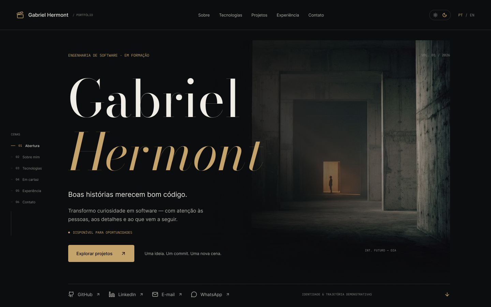
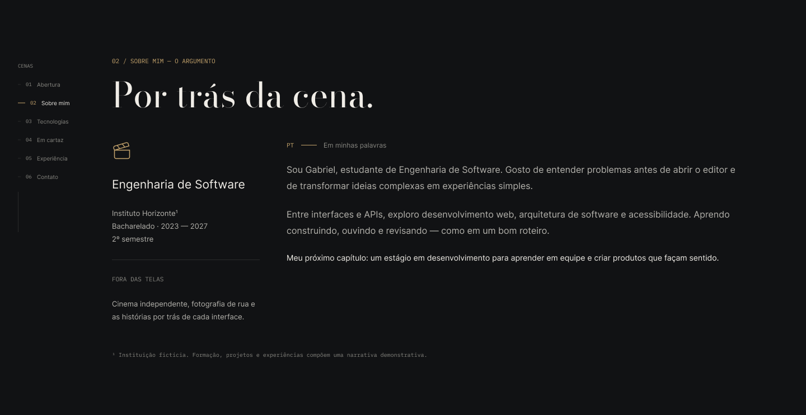
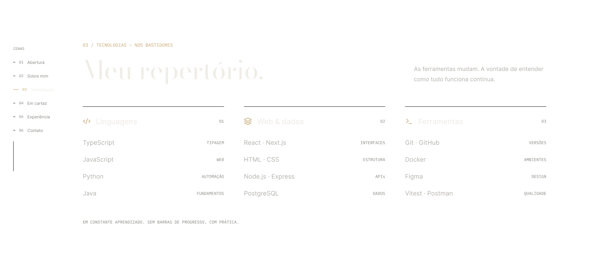
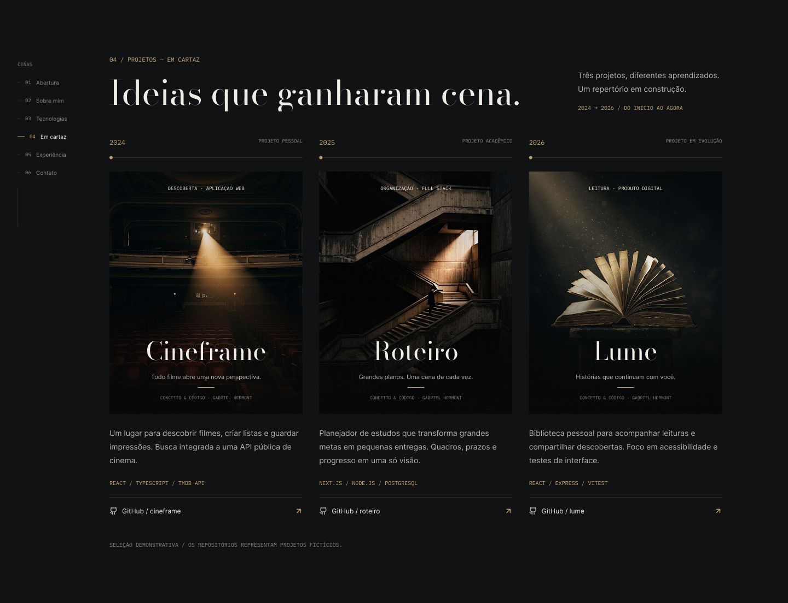
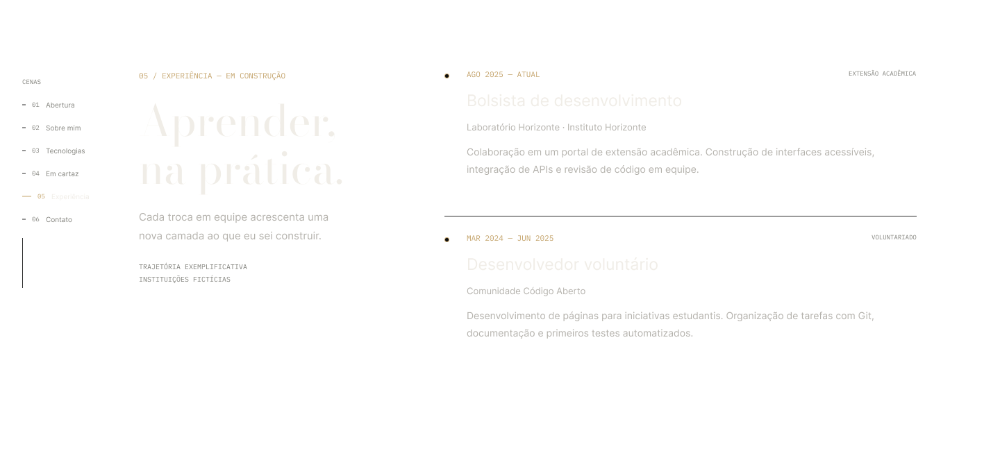
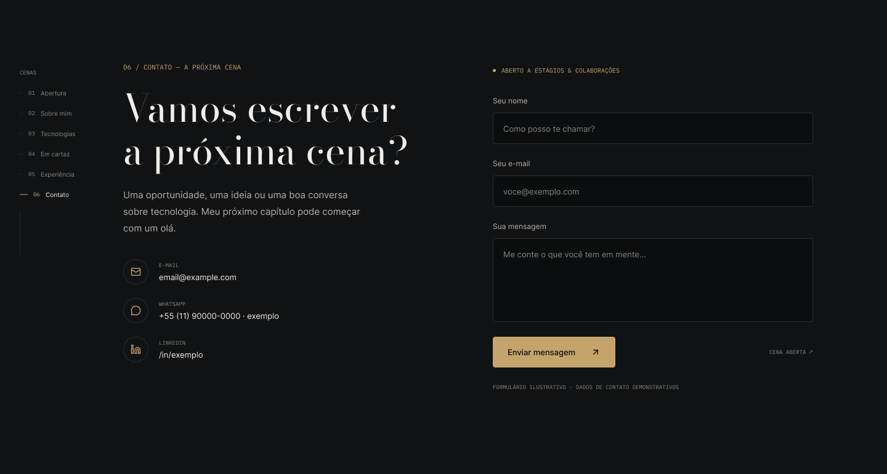
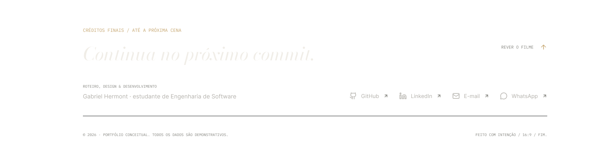

# 🎬 Portfólio Profissional — Gabriel Hermont

> [!NOTE]
> Website de portfólio profissional desenvolvido para apresentar minha trajetória,
> habilidades e projetos — com uma identidade visual inspirada no universo do **cinema**.
> Projeto da disciplina **Desenvolvimento e Integração de Aplicações Web (DIAW)** —
> Engenharia de Software, PUC Minas.

---

## 🚧 Status do Projeto


> 🟡 **Sprint atual:** Lab01S01 — Planejamento e prototipação.

---

## 📚 Índice

- [Sobre o Projeto](#-sobre-o-projeto)
- [Funcionalidades Principais](#-funcionalidades-principais)
- [Tecnologias Utilizadas](#-tecnologias-utilizadas)
- [Protótipos e Design](#-protótipos-e-design)
- [Estrutura de Pastas](#-estrutura-de-pastas)
- [Instalação e Execução](#-instalação-e-execução)
  - [Pré-requisitos](#pré-requisitos)
  - [Passo a passo](#passo-a-passo)
  - [Scripts disponíveis](#scripts-disponíveis)
  - [Variáveis de ambiente](#variáveis-de-ambiente)
- [Deploy](#-deploy)
- [Demonstração](#-demonstração)
- [Documentações Utilizadas](#-documentações-utilizadas)
- [Autor](#-autor)
- [Licença](#-licença)

---

## 📝 Sobre o Projeto

Este é o meu **portfólio profissional**, desenvolvido como projeto da disciplina
**Desenvolvimento e Integração de Aplicações Web (DIAW)** do curso de
**Engenharia de Software da PUC Minas**.

O objetivo é reunir, em um único lugar, as informações mais relevantes sobre a minha
trajetória acadêmica e profissional, apresentando:

- Quem eu sou e meus objetivos profissionais (em **português** e **inglês**);
- Os **projetos** que desenvolvi;
- Minhas **experiências** profissionais e acadêmicas;
- Formas de **contato** direto.

O site foi construído com foco em **design responsivo**, **boa usabilidade**,
**código limpo e de fácil manutenção**, e uma **identidade visual coerente** com o meu
perfil profissional. A proposta visual é inspirada no universo do **cinema**: uma
experiência escura, elegante e minimalista (preto e dourado), em que cada seção é
apresentada como uma "cena" de um roteiro.

---

## ✨ Funcionalidades Principais

> As funcionalidades abaixo representam o escopo planejado do portfólio.
> O status indica o que já foi implementado em cada sprint.

- 🌐 **Internacionalização (i18n):** conteúdo disponível em **português** e **inglês**. ⏳ _Planejado_
- 👤 **Sobre Mim:** apresentação pessoal com formação, atuação, interesses e objetivos. ⏳ _Planejado_
- 🗂️ **Projetos:** linha do tempo (timeline) com nome, descrição, tecnologias, link do GitHub e imagem/GIF de cada projeto. ⏳ _Planejado_
- 💼 **Experiências:** histórico profissional e acadêmico com instituição, cargo, período e descrição. ⏳ _Planejado_
- 📬 **Contato:** ícones clicáveis (e-mail, WhatsApp, LinkedIn) e formulário com envio de e-mail. ⏳ _Planejado_
- 🎨 **Temas:** alternância entre tema **claro** e **escuro**. ⏳ _Planejado_
- 🎬 **Identidade cinematográfica:** rótulos de "cena", índice lateral estilo linha do tempo e transições suaves. ⏳ _Planejado_
- 📱 **Design responsivo:** adaptação a desktop, tablet e mobile. ⏳ _Planejado_

---

## 🛠 Tecnologias Utilizadas

As seguintes ferramentas, bibliotecas e serviços foram (ou serão) utilizados na
construção deste projeto.

### 💻 Front-end

| Tecnologia | Versão | Descrição |
| :--- | :--- | :--- |
| [React](https://react.dev/) | 19 | Biblioteca JavaScript para construção da interface em componentes. |
| [Vite](https://vite.dev/) | 7 | Build tool e servidor de desenvolvimento rápido. |
| JavaScript (ES6+) | — | Linguagem de programação principal do projeto. |
| CSS | — | Estilização das páginas e componentes (CSS Modules + variáveis de tema). |

### 📦 Bibliotecas Previstas

| Biblioteca | Descrição |
| :--- | :--- |
| [React Hook Form](https://react-hook-form.com/) | Gerenciamento e validação do formulário de contato. ⏳ _Planejado_ |
| [EmailJS](https://www.emailjs.com/) | Envio de e-mail diretamente do front-end, sem back-end. ⏳ _Planejado_ |
| [Framer Motion](https://www.framer.com/motion/) | Animações e transições suaves entre as seções. ⏳ _Planejado_ |

### 🚀 Infraestrutura & Deploy

| Tecnologia | Descrição |
| :--- | :--- |
| [Vercel](https://vercel.com/) | Hospedagem do front-end com deploy contínuo a partir do GitHub. ⏳ _Planejado_ |
| [Git](https://git-scm.com/) & [GitHub](https://github.com/) | Controle de versão e hospedagem do código-fonte. |

### 🔧 Ferramentas de Desenvolvimento

| Ferramenta | Descrição |
| :--- | :--- |
| [ESLint](https://eslint.org/) | Linter para análise estática e qualidade de código. |
| [Prettier](https://prettier.io/) | Formatação automática e padronização do código. |

> [!NOTE]
> Esta lista será atualizada conforme novas bibliotecas forem adicionadas ao projeto.

---

## 🎨 Protótipos e Design

O design e o protótipo deste portfólio foram elaborados antes do desenvolvimento,
servindo como referência visual para a implementação.

A identidade visual segue um conceito **cinematográfico**: base escura (preto),
dourado como cor de destaque, tipografia moderna e seções apresentadas como "cenas"
de um roteiro, com um índice lateral que acompanha a rolagem no estilo de uma linha
do tempo de vídeo.

- 🔗 **Protótipo navegável (Figma):** `<link do protótipo no Figma — em breve>`

### 🖼️ Telas do protótipo

> [!NOTE]
> As imagens abaixo são do protótipo de alta fidelidade (tema escuro) e representam
> cada "cena" da landing page. Poderão ser atualizadas conforme o design evoluir.

| 🎬 Abertura | 👤 Sobre mim |
| :---: | :---: |
|  |  |
| **🛠 Tecnologias** | **🗂️ Em cartaz (Projetos)** |
|  |  |
| **💼 Experiência** | **📬 Contato** |
|  |  |
| **🎞️ Créditos finais** | |
|  | |

---

## 📂 Estrutura de Pastas

A estrutura abaixo descreve a organização planejada do projeto (front-end em React + Vite).

```
gbhermont-portfolio/
├── docs/                       # 📚 Documentação e protótipos
│   └── prototipos/             # 🖼️ Imagens do protótipo (usadas no README)
├── public/                     # 📂 Arquivos estáticos servidos diretamente (favicon, etc.)
├── src/                        # 📂 Código-fonte da aplicação
│   ├── assets/                 # 🖼️ Imagens e recursos importados no código
│   ├── components/             # 🧱 Componentes reutilizáveis
│   │   ├── layout/             #    Navbar, Footer, índice lateral (scroll spy)
│   │   ├── editorial/          #    Rótulos de "cena", divisores (film strip)
│   │   └── ui/                 #    Botões, toggle de tema, seletor de idioma
│   ├── sections/               # 🎬 Seções da landing page (uma por "cena")
│   │   ├── Hero.jsx            #    Abertura (hero)
│   │   ├── About.jsx           #    Sobre (Scene 01)
│   │   ├── Projects.jsx        #    Projetos (Scene 02)
│   │   ├── Experience.jsx      #    Experiência (Scene 03)
│   │   └── Contact.jsx         #    Contato (Scene 04)
│   ├── data/                   # 🗂️ Conteúdo separado da apresentação
│   │   ├── profile.js          #    Dados do perfil
│   │   ├── projects.js         #    Lista de projetos
│   │   └── experiences.js      #    Lista de experiências
│   ├── i18n/                   # 🌐 Dicionários de tradução (PT/EN)
│   ├── theme/                  # 🎨 Tokens de design e temas (claro/escuro)
│   ├── hooks/                  # 🎣 Hooks personalizados (useTheme, useLanguage)
│   ├── App.jsx                 # 🧩 Componente raiz: monta as seções
│   ├── main.jsx                # 🚪 Ponto de entrada: renderiza o App no HTML
│   └── index.css               # 🎨 Estilos globais (tokens de design e temas)
├── index.html                  # 📄 Página HTML base onde o React é injetado
├── package.json                # 📦 Dependências, scripts e metadados do projeto
├── vite.config.js              # ⚙️ Configuração do Vite
├── .env.example                # 🔑 Exemplo de variáveis de ambiente (EmailJS)
├── .gitignore                  # 🧹 Arquivos e pastas ignorados pelo Git
└── README.md                   # 📘 Documentação do projeto (este arquivo)
```

> [!NOTE]
> A estrutura acima representa a organização planejada e poderá ser ajustada
> ao longo do desenvolvimento.

---

## 🔧 Instalação e Execução

Siga os passos abaixo para rodar o projeto localmente na sua máquina.

### Pré-requisitos

- [Node.js](https://nodejs.org/) versão **18 ou superior** (recomendado: LTS)
- [npm](https://www.npmjs.com/) (instalado junto com o Node.js) ou outro gerenciador de pacotes
- [Git](https://git-scm.com/)

### Passo a passo

```bash
# 1. Clone o repositório
git clone https://github.com/gbhermont/gbhermont-portfolio.git

# 2. Acesse a pasta do projeto
cd gbhermont-portfolio

# 3. Instale as dependências
npm install

# 4. Rode o projeto em modo de desenvolvimento
npm run dev
```

Após executar `npm run dev`, o terminal exibirá um endereço local
(geralmente <http://localhost:5173>). Abra esse endereço no navegador para
visualizar o portfólio.

### Scripts disponíveis

| Script | Comando | Descrição |
| :--- | :--- | :--- |
| Desenvolvimento | `npm run dev` | Inicia o servidor local de desenvolvimento. |
| Build | `npm run build` | Gera a versão otimizada para produção na pasta `dist/`. |
| Preview | `npm run preview` | Visualiza localmente a versão de produção gerada. |
| Lint | `npm run lint` | Analisa o código em busca de problemas de qualidade. |

### Variáveis de ambiente

> [!NOTE]
> O envio do formulário de contato usará o **EmailJS**. As chaves necessárias devem
> ser configuradas em um arquivo `.env` na raiz do projeto (com o prefixo `VITE_`).
> Um arquivo `.env.example` é disponibilizado como referência.

Exemplo de variáveis previstas:

```env
# EmailJS (envio do formulário de contato)
VITE_EMAILJS_SERVICE_ID=<seu-service-id>
VITE_EMAILJS_TEMPLATE_ID=<seu-template-id>
VITE_EMAILJS_PUBLIC_KEY=<sua-public-key>
```

---

## 🚀 Deploy

O deploy será realizado na **[Vercel](https://vercel.com/)**, com publicação
automática a cada atualização enviada para a branch principal do repositório no GitHub.

- 🌐 **Site publicado:** `<link do deploy na Vercel — em breve>`

> [!NOTE]
> O link de acesso ao site hospedado será adicionado nesta seção na entrega da
> Sprint Lab01S03.

---

## 🎥 Demonstração

> [!NOTE]
> As imagens e GIFs demonstrando o site e os projetos em funcionamento serão
> adicionados aqui ao longo do desenvolvimento (previsto para a Sprint Lab01S03).

---

## 🔗 Documentações Utilizadas

- 📖 [Documentação oficial do React](https://react.dev/)
- 📖 [Guia de configuração do Vite](https://vite.dev/config/)
- 📖 [Documentação do EmailJS](https://www.emailjs.com/docs/)
- 📖 [Documentação do React Hook Form](https://react-hook-form.com/get-started)
- 📖 [Documentação da Vercel](https://vercel.com/docs)
- 📖 [Conventional Commits (padrão de mensagens de commit)](https://www.conventionalcommits.org/pt-br/v1.0.0/)

---

## 👤 Autor

| Nome | GitHub | LinkedIn | E-mail |
| :--- | :--- | :--- | :--- |
| **Gabriel Hermont** | [@gbhermont](https://github.com/gbhermont) | `<seu LinkedIn>` | `<seu e-mail>` |

---

## 📄 Licença

Este projeto está licenciado sob a **Licença MIT**. Consulte o arquivo
[LICENSE](LICENSE) para mais detalhes.

---

> Projeto acadêmico desenvolvido para a disciplina **DIAW** —
> Prof. Dr. João Paulo Carneiro Aramuni · Engenharia de Software · PUC Minas.
